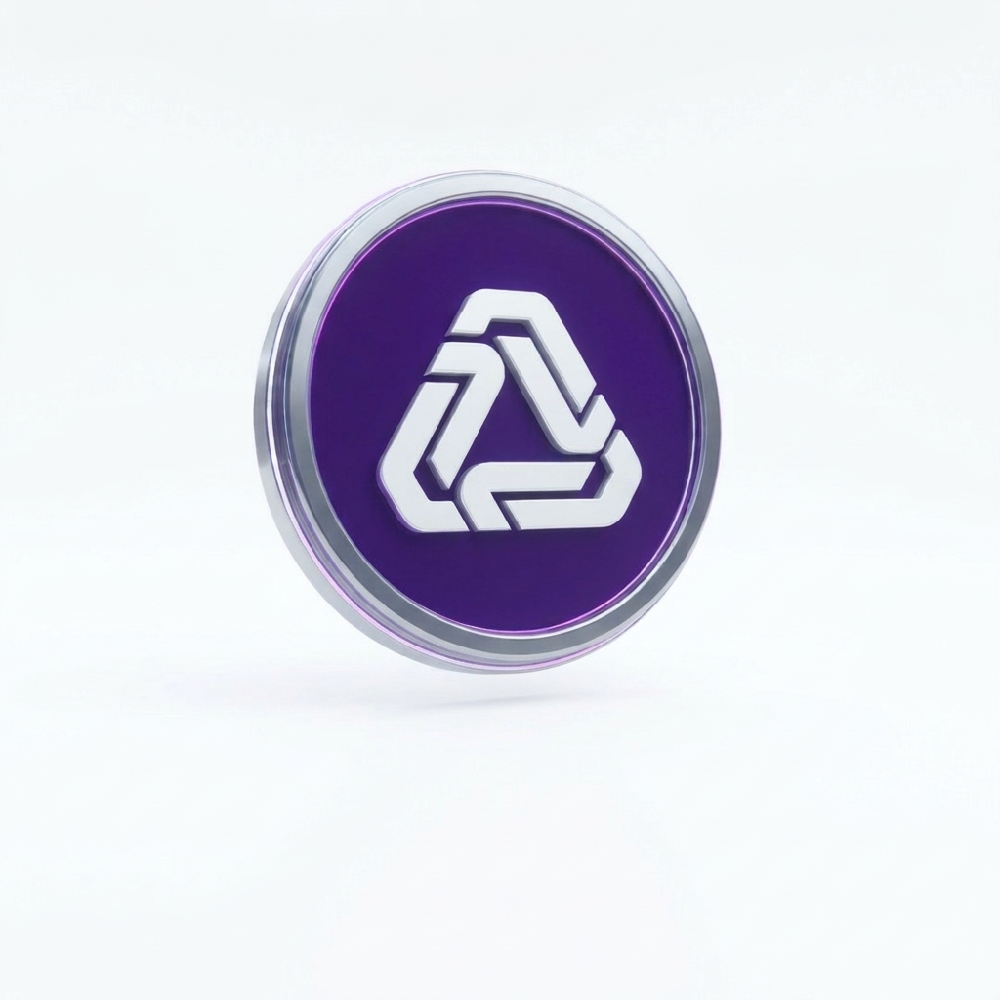

# Hi, I'm RAY 👋

### Founder & Project Lead at ADUBA Chain

I'm building ADUBA Chain, an independent Layer-1 blockchain focused on interoperability, EVM compatibility, and a developer-oriented Web3 ecosystem.

My role focuses on project vision, ecosystem strategy, technical direction, and building the team behind ADUBA.

---

## 🚀 About ADUBA Chain

ADUBA Chain is an independent Layer-1 blockchain currently under development.

The project aims to combine:

- Cosmos SDK-based blockchain architecture
- EVM compatibility
- IBC interoperability
- Native ADU token
- ADF-20 application token standard
- Cross-chain ecosystem development

Our long-term goal is to build an interoperable blockchain ecosystem that supports developers, applications, and decentralized finance.

---

## ⚙️ Technology

The ADUBA Chain architecture is built around:

- Cosmos SDK
- Cosmos EVM
- CometBFT
- Ethereum Virtual Machine (EVM)
- Inter-Blockchain Communication (IBC)
- Go

---

## 🪙 ADUBA Ecosystem

**ADU**

  

  <h1>ADUBA CHAIN</h1>

  

    <strong>An Interoperable Layer-1 Blockchain Ecosystem</strong>
  

The native token of the ADUBA network, designed for network gas fees and ecosystem utility.

**ADF-20**

ADUBA's application token standard, designed to support tokens and applications within the ecosystem.

---

## 🌐 Planned Ecosystem Applications

ADUBA aims to develop an integrated blockchain ecosystem.

Planned ecosystem components include:

- ADUBA Block Explorer
- ADUBA Bridge
- ADUBA Swap
- ADUBA DEX
- ADUBA Launchpad
- ADUBA Wallet

These components are part of the long-term ecosystem roadmap and will be developed progressively.

**Official Website:** Coming Soon  
**Planned Domain:** aduba.id

---

## 🛠️ Current Development

Current development priorities include:

- ADUBA Layer-1 core infrastructure
- Testnet development and validation
- EVM compatibility
- IBC interoperability
- Developer infrastructure
- Ecosystem planning and development

Features and integrations are being developed and validated progressively.

---

## 🛡️ Engineering Philosophy & Core Principles

Our development philosophy is built around three fundamental principles:

### 1. Stability
Building reliable, consistent, and resilient blockchain infrastructure and applications that users and developers can depend on.

### 2. Flexibility
Creating flexible, modular, and adaptable technologies that empower developers to build applications and enable users to interact with the ecosystem seamlessly.

### 3. Security & Trust
Prioritizing security throughout the development lifecycle to protect users, developers, and the ecosystem while establishing long-term trust through responsible engineering.

Our mission is to build a blockchain ecosystem where stability, flexibility, and security work together to create a reliable environment for users and developers.

**Built for Stability. Designed for Flexibility. Engineered for Security.**

---

## 🤝 Building the Team

ADUBA is exploring collaboration with experienced people in:

- Blockchain engineering
- Business development
- Strategic partnerships
- Ecosystem development
- Web3 infrastructure

We welcome meaningful discussions with developers, builders, and potential strategic partners.

---

## 📩 Contact

For business inquiries, partnerships, and collaboration:

**Email:** founder@aduba.my.id

---

## 🔗 Links

- GitHub: https://github.com/exploreidr-id
- ADUBA-NODE: https://github.com/exploreidr-id/ADUBA-NODE

---

**Building ADUBA Chain — An interoperable Layer-1 ecosystem.**
