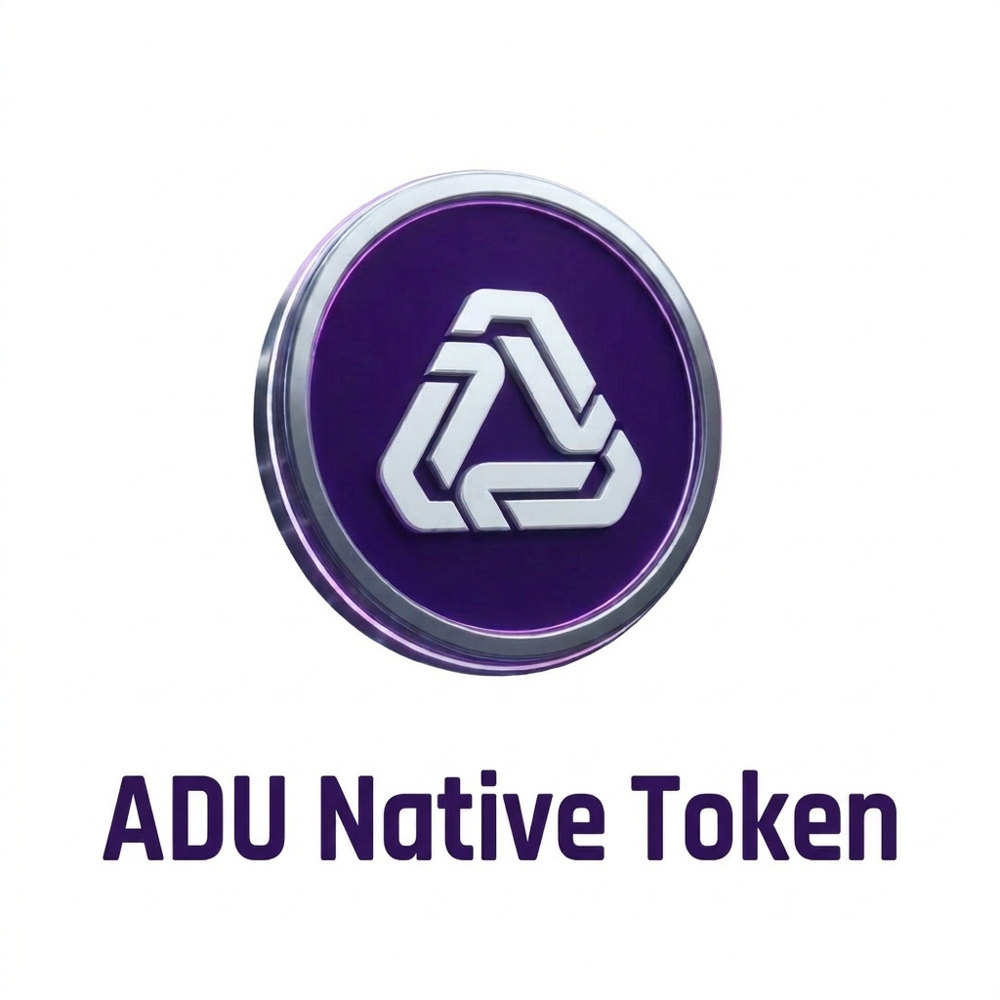

# Hi, I'm RAY 👋

  

### Founder & Project Lead at ADUBA Chain

I'm building ADUBA Chain, an independent Layer-1 blockchain focused on interoperability, EVM compatibility, and a developer-oriented Web3 ecosystem.

My role focuses on project vision, ecosystem strategy, technical direction, and building the team behind ADUBA.

---

## 🚀 About ADUBA Chain

ADUBA Chain is an independent Layer-1 blockchain currently under development.

The project aims to combine:

- Cosmos SDK-based blockchain architecture
- EVM compatibility
- IBC interoperability
- Native ADU token
- ADF-20 application token standard
- Cross-chain ecosystem development

Our long-term goal is to build an interoperable blockchain ecosystem that supports developers, applications, and decentralized finance.

---

## ⚙️ Technology

The ADUBA Chain architecture is built around:

- Cosmos SDK
- Cosmos EVM
- CometBFT
- Ethereum Virtual Machine (EVM)
- Inter-Blockchain Communication (IBC)
- Go

---

## 🪙 ADUBA Ecosystem

### ADU — Native Token

  

ADU is the native token of ADUBA Chain and serves as the primary digital asset of the network.

Its primary utilities include:

- Network gas fee payments.
- Ecosystem utility.
- Network governance.
- Supporting the growth and sustainability of the ADUBA ecosystem.

| Parameter | Details |
|---|---|
| Token Name | ADUBA |
| Token Symbol | ADU |
| Token Type | Native Layer-1 Token |
| Blockchain | ADUBA Chain |
| EVM Denomination | aadu |
| Display Denomination | ADU |
| Decimals | 18 |
| Maximum Supply Target | 750,000,000 ADU |

### ADF-20 — Unified Fungible Asset Standard

ADF-20 is proposed as ADUBA's Unified Fungible Asset Standard, designed to connect EVM-compatible token interfaces with the native asset infrastructure of the Cosmos SDK.

Its architectural objectives include:

- **EVM Compatibility:** Supporting familiar ERC-20 interfaces for Solidity developers and EVM-compatible applications.
- **Cosmos SDK Integration:** Connecting token balances and asset operations with the Cosmos SDK `x/bank` module.
- **Unified Asset Architecture:** Establishing consistent asset representation across EVM and Cosmos environments.
- **IBC Interoperability:** Designing support for cross-chain asset transfers through IBC/ICS-20, subject to implementation and compatibility requirements.
- **Developer Accessibility:** Supporting familiar development tools and interfaces across the EVM ecosystem.

ADF-20 is intended to complement ADF-1, not replace it.

ADF-1 focuses on **token creation**, while ADF-20 focuses on **fungible asset representation, management, and interoperability**.

*Both standards are under development and subject to technical implementation, testing, and validation.*

Key capabilities include:

- Standardized token implementation.
- Creation and management of ecosystem tokens.
- Smart contract integration.
- Support for decentralized applications (dApps).
- Integration with the broader ADUBA ecosystem.

**Important Distinction:**

ADU is the native token of ADUBA Chain, while ADF-20 is a token standard that enables applications to issue and manage their own tokens.

ADF-20 is not a standalone cryptocurrency or native token.
---

## 🌐 Planned Ecosystem Applications

ADUBA aims to develop an integrated blockchain ecosystem.

Planned ecosystem components include:

- ADUBA Block Explorer
- ADUBA Bridge
- ADUBA Swap
- ADUBA DEX
- ADUBA Launchpad
- ADUBA Wallet

These components are part of the long-term ecosystem roadmap and will be developed progressively.

**Official Website:** Coming Soon  
**Planned Domain:** aduba.id

---

## 🛠️ Current Development

Current development priorities include:

- ADUBA Layer-1 core infrastructure
- Testnet development and validation
- EVM compatibility
- IBC interoperability
- Developer infrastructure
- Ecosystem planning and development

Features and integrations are being developed and validated progressively.

---

## 🌐 Network Development Status

ADUBA Chain is progressing through its Layer-1 development and network validation phases.

Current development status:

- Layer-1 Core: Under Development
- Testnet: Active Testing and Validation
- EVM Compatibility: Under Development and Validation
- IBC Interoperability: Development and Integration
- Mainnet: Planned

ADUBA follows a progressive development approach, prioritizing network stability, security, and interoperability before mainnet deployment.

Network capabilities and development milestones will be updated as validation progresses.

---

## 🛡️ Engineering Philosophy & Core Principles

Our development philosophy is built around three fundamental principles:

### 1. Stability
Building reliable, consistent, and resilient blockchain infrastructure and applications that users and developers can depend on.

### 2. Flexibility
Creating flexible, modular, and adaptable technologies that empower developers to build applications and enable users to interact with the ecosystem seamlessly.

### 3. Security & Trust
Prioritizing security throughout the development lifecycle to protect users, developers, and the ecosystem while establishing long-term trust through responsible engineering.

Our mission is to build a blockchain ecosystem where stability, flexibility, and security work together to create a reliable environment for users and developers.

**Built for Stability. Designed for Flexibility. Engineered for Security.**

---

## 🔐 ADUBA Security-First Engineering Policy

Security is a fundamental engineering responsibility across the entire ADUBA ecosystem.

Our security-first approach covers:

- Consensus and network infrastructure.
- Validators and key management.
- EVM and smart contracts.
- ADF-20 token implementations.
- Cross-chain bridges and interoperability.
- Wallet infrastructure and asset management.
- Network operations and governance.

Critical components handling real-value assets should undergo appropriate testing, security assessments, and independent reviews before production deployment.

Our objective is to establish a secure, resilient, and trustworthy blockchain ecosystem through continuous security improvements.
---

## 🤝 Building the Team

ADUBA is exploring collaboration with experienced people in:

- Blockchain engineering
- Business development
- Strategic partnerships
- Ecosystem development
- Web3 infrastructure

We welcome meaningful discussions with developers, builders, and potential strategic partners.

---

## 📩 Contact

For business inquiries, partnerships, and collaboration:

**Email:** founder@aduba.my.id

---

## 🔗 Links

- GitHub: https://github.com/exploreidr-id
- ADUBA-NODE: https://github.com/exploreidr-id/ADUBA-NODE

---

**Building ADUBA Chain — An interoperable Layer-1 ecosystem.**
